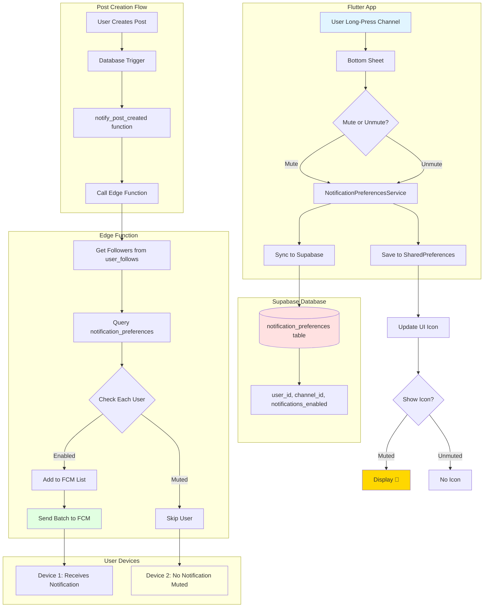
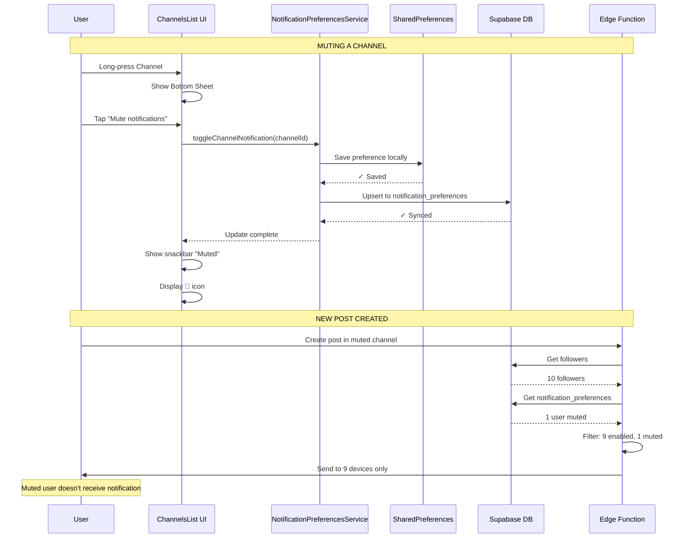
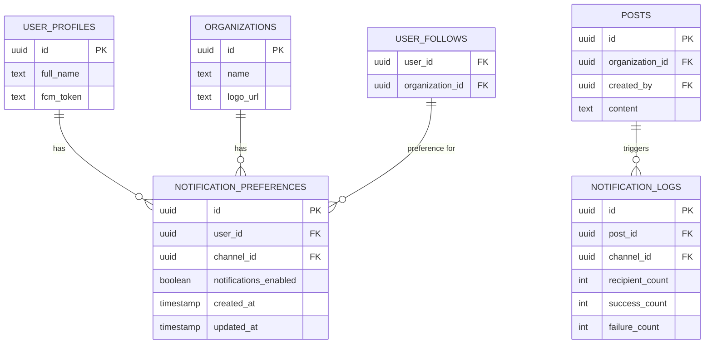
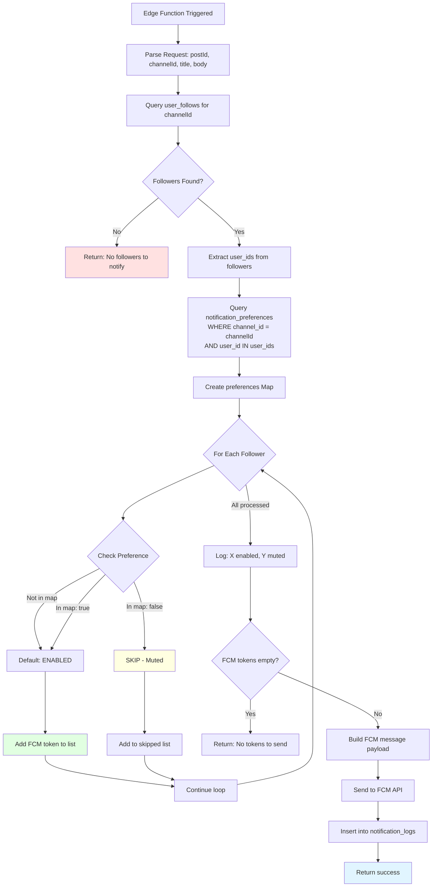
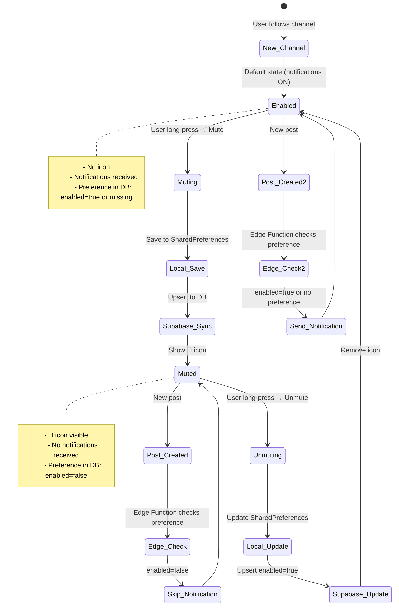
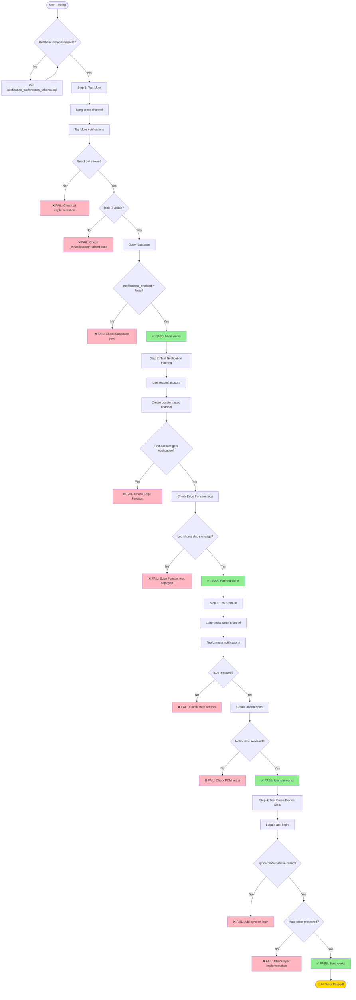
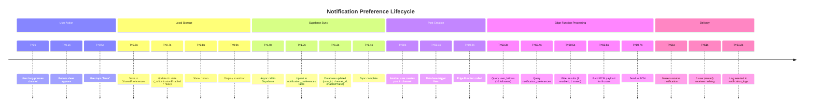
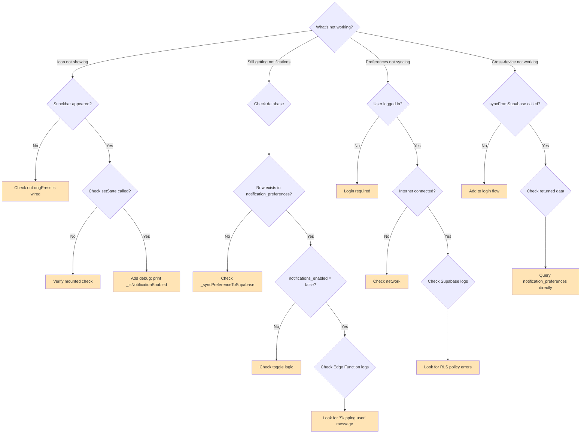

# Notification Mute/Unmute System - Visual Diagrams

## 1. Complete System Architecture



## 2. User Interaction Flow



## 3. Database Schema & Relationships



## 4. Edge Function Logic Flow



## 5. Testing Flow Diagram

```mermaid
graph LR
    subgraph "Setup Phase"
        A1[Run notification_preferences_schema.sql] --> A2[Deploy Edge Function]
        A2 --> A3[Add syncFromSupabase on login]
    end
    
    subgraph "Test 1: Mute Channel"
        B1[Open App] --> B2[Long-press Channel A]
        B2 --> B3[Tap 'Mute notifications']
        B3 --> B4{Icon visible?}
        B4 -->|Yes ✓| B5[Check Database]
        B4 -->|No ✗| B6[Debug: Check _loadNotificationState]
        B5 --> B7{Row exists with enabled=false?}
        B7 -->|Yes ✓| B8[Test 1 PASS]
        B7 -->|No ✗| B9[Debug: Check Supabase sync]
    end
    
    subgraph "Test 2: Verify No Notification"
        C1[Use Account 2] --> C2[Create Post in Channel A]
        C2 --> C3{Account 1 receives notification?}
        C3 -->|No ✓| C4[Check Edge Function Logs]
        C3 -->|Yes ✗| C5[Debug: Check Edge Function filtering]
        C4 --> C6{Log shows 'Skipping user'?}
        C6 -->|Yes ✓| C7[Test 2 PASS]
        C6 -->|No ✗| C8[Debug: Edge Function not filtering]
    end
    
    subgraph "Test 3: Unmute Channel"
        D1[Long-press Channel A again] --> D2[Tap 'Unmute notifications']
        D2 --> D3{Icon removed?}
        D3 -->|Yes ✓| D4[Create another post]
        D3 -->|No ✗| D5[Debug: Check setState]
        D4 --> D6{Notification received?}
        D6 -->|Yes ✓| D7[Test 3 PASS]
        D6 -->|No ✗| D8[Debug: Check FCM token]
    end
    
    A3 --> B1
    B8 --> C1
    C7 --> D1
    
    style B8 fill:#90EE90
    style C7 fill:#90EE90
    style D7 fill:#90EE90
    style B6 fill:#FFB6C1
    style B9 fill:#FFB6C1
    style C5 fill:#FFB6C1
    style C8 fill:#FFB6C1
    style D5 fill:#FFB6C1
    style D8 fill:#FFB6C1
```



## 6. State Transitions



## 7. Complete Testing Checklist



## 8. Data Flow Timeline



## 9. Troubleshooting Decision Tree



---

## Quick Reference Commands

```bash
# Setup
cd supabase
supabase sql < notification_preferences_schema.sql
supabase functions deploy send-fcm-notification

# Check database
SELECT * FROM notification_preferences WHERE user_id = auth.uid();

# View logs
supabase functions logs send-fcm-notification --tail

# Test query
SELECT 
  up.full_name,
  o.name as channel,
  np.notifications_enabled
FROM notification_preferences np
JOIN user_profiles up ON np.user_id = up.id
JOIN organizations o ON np.channel_id = o.id
WHERE np.user_id = auth.uid();
```
